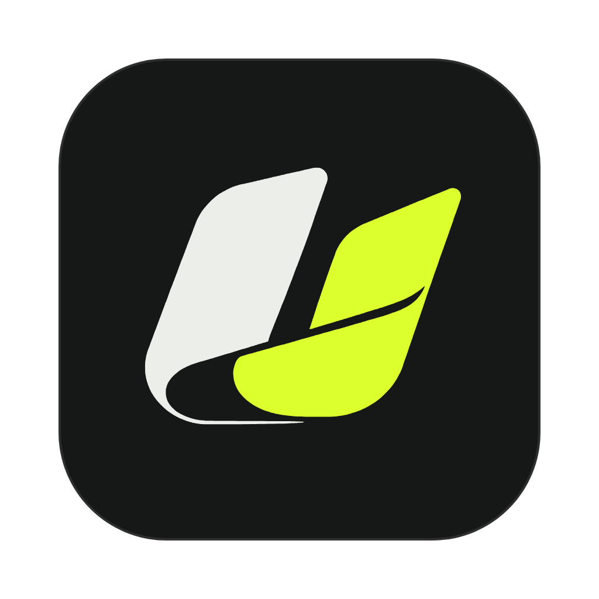

# Uplink

**Watch a lesson. Uplink it to your AI.**

Uplink sits in your menu bar (Mac) or system tray (Windows). Press one shortcut when a course, tutorial or YouTube video starts. When it ends, your AI writes clear notes from the lesson, with screenshots of the important moments, and sends them to the agents that need them. Your design agent gets the design lessons, your marketing agent gets the marketing ones, and they read them before their next job.

Works with **Claude, ChatGPT and Gemini** (the apps you already use, or an API key), or a free local model.

## Install

### The easy way: let your AI install it
If you use **Claude Code, Codex or Gemini CLI**, paste this into it:

```
Install Uplink for me from https://github.com/Teeblaze/uplink. Read AI-INSTALL.md in that repo and follow it step by step on this computer. Ask me before anything that needs my password.
```

### Or run one line yourself
**Mac** (macOS 14 or newer), in Terminal:
```bash
curl -fsSL https://raw.githubusercontent.com/Teeblaze/uplink/main/install.sh | bash
```

**Windows** (10 or 11), in PowerShell:
```powershell
irm https://raw.githubusercontent.com/Teeblaze/uplink/main/windows/install.ps1 | iex
```

It takes about 5 minutes. Settings opens in your browser at the end.

## Use
| | Mac | Windows |
|---|---|---|
| Start or stop a lesson | Ctrl+Option+N | Ctrl+Alt+N |
| Add a spoken note while it records | hold Ctrl+Option+M | hold Ctrl+Alt+M |
| Ask about your screen | hold Ctrl+Option+A | hold Ctrl+Alt+A |

Change any of them in **Settings > Your shortcuts**: click a box and press the keys you want.

**Ask about your screen:** hold the key and ask, for example "where do I export this?". Your AI looks at the screen, answers out loud and in writing, and marks the spot with a still ring, or with a gliding pointer if you turn that on in Settings. Your real mouse never moves. Questions asked during a lesson go into that lesson's notes, and on to your agents.

The menu also has **Ask my library** (answers only from your notes, with the lesson and timestamp for each point), **Open last notes**, **Take screenshots of the lesson** (on by default) and **Settings**.

## Settings
- **Your AI.** Claude Code, Codex (ChatGPT) or Gemini CLI use the sign-in you already have. Or paste a Claude, OpenAI or Gemini API key (pay per use). Or run a free model on your own computer with [Ollama](https://ollama.com). Press **Test** to check the connection.
- **Notes library.** One folder of plain text notes, with each lesson's full transcript and screenshots. Default: `Documents/Uplink Library`.
- **Who learns from your notes.** Uplink finds the agents and skills you have in Claude Code, Codex and Gemini CLI. Tick the ones that should learn. For each lesson your AI picks the agents it fits; each ticked agent gets a reading list and one line in its instructions to read it before a job.
- **Custom GPTs, Gems and Claude Projects.** Add them by name. Those apps do not accept files from other apps, so each gets an upload folder (`for-upload/<name>`); add the new notes to its files yourself.
- **Tell your AI about the library.** Adds one short paragraph to `CLAUDE.md`, `AGENTS.md` or `GEMINI.md`, so every chat knows where your notes are.

## What happens to your data
- The lesson sound is transcribed **on your computer** (faster-whisper). Audio is deleted once the notes are written.
- The transcript and up to 40 screenshots go to the AI you picked, and nowhere else.
- Notes, settings and API keys stay on your computer. Keys are kept in a settings file only you can read.
- On Mac, Uplink records only the app in front when you press start (for example your browser), not every sound on the computer. On Windows it records all sound, so keep other audio off.

## Good to know
- Uplink hears and sees the lesson; it does not log in anywhere or download videos.
- Python 3.12 is used because the speech-to-text package does not support newer versions yet. The installer sets it up.
- The Mac app is built on your Mac during install, so it needs Apple's free Command Line Tools (the installer asks for them).

## How it is built
| File | What it does |
|---|---|
| `Uplink.swift` | Mac menu-bar app: records the lesson's sound and smart screenshots (ScreenCaptureKit), spoken notes, shortcuts |
| `windows/uplink_win.py` | Windows tray app with the same features |
| `transcribe.py` | Speech to text on your computer |
| `make_notes.py` | Sends the transcript and screenshots to your AI and files the notes for your agents |
| `ai.py` | One adapter per AI: Claude Code, Codex, Gemini CLI, Claude API, OpenAI API, Gemini API, Ollama |
| `nt_config.py` | Settings, finding your AI apps and agents, linking agents to their reading lists |
| `settings.py`, `settings.html` | The Settings page (runs on your computer only) |
| `ask.py` | Ask my library |
| `ask_screen.py` | Ask about your screen: speech to text, then your AI answers from a screenshot |
| `notes_prompt_generic.md` | The instructions your AI gets for writing notes |

Made by Adetayo Apena (MrTb) at Grids. MIT licence.

"Ask about your screen" is inspired by [Clicky](https://github.com/farzaa/clicky) by Farza (MIT licence), an AI teacher that sees your screen, talks and points.
